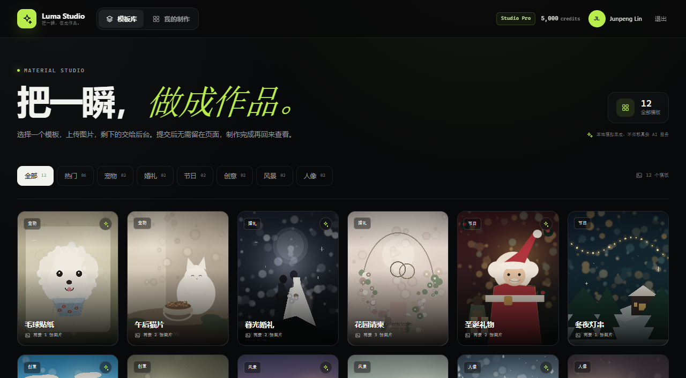
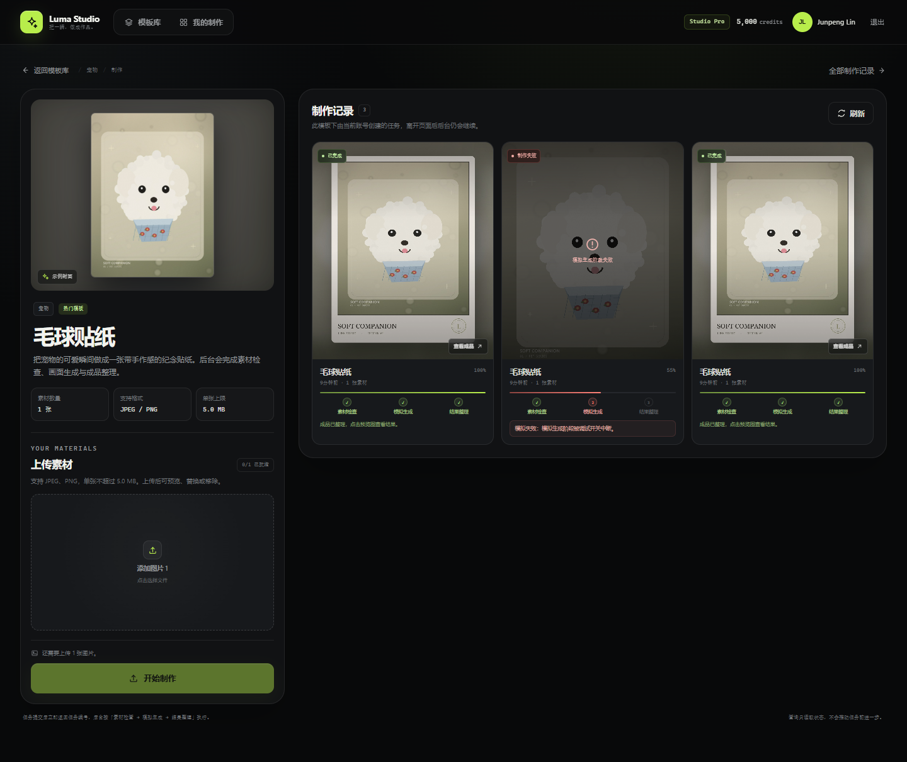
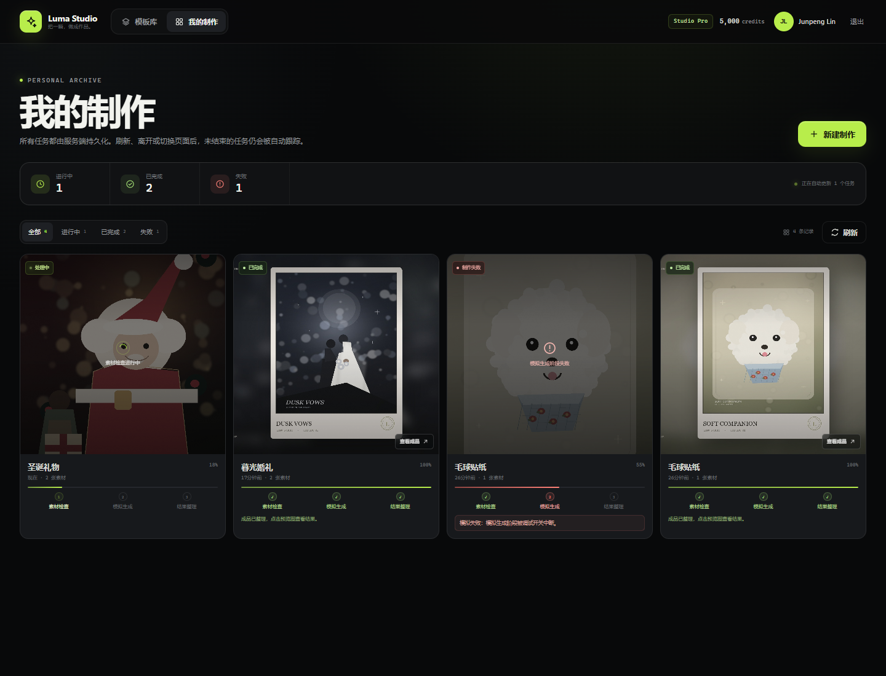
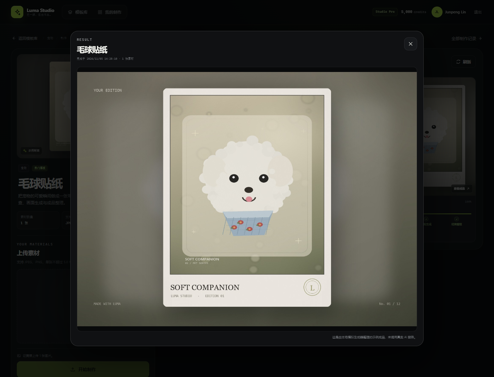
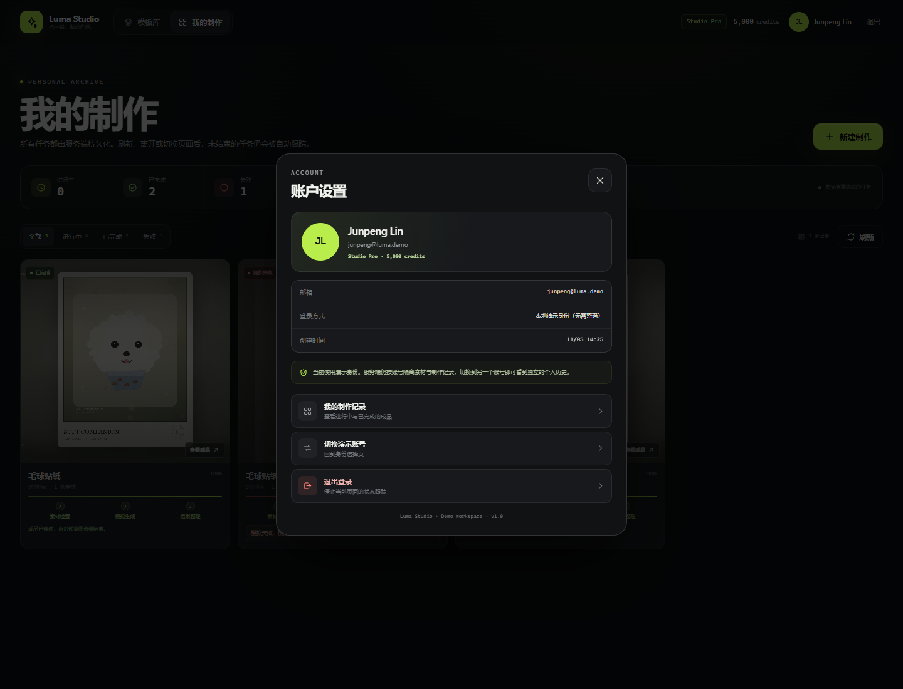
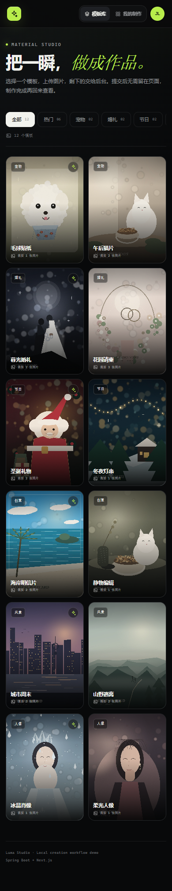

# Luma Studio · 素材制作站

一个可独立运行的全栈素材制作演示项目：浏览模板、上传图片、提交后台任务，在任务处理期间继续浏览，最后在个人历史中查看状态与成品。

制作过程**不调用真实 AI 服务**。后端按「素材检查 → 模拟生成 → 结果整理」三个独立阶段执行，通过可调整耗时与可指定阶段失败的确定性模拟器完成业务闭环。前端使用轮询跟踪未结束任务，并把「任务失败」与「查询接口暂时不可用」严格区分。

远程仓库：<https://github.com/ymj408/video>



| 模板详情与后台任务 | 个人历史（处理中 / 成功 / 失败） |
| --- | --- |
|  |  |

| 成品预览 | 账户设置 |
| --- | --- |
|  |  |

移动端可操作（390px 下无横向溢出）：



---

## 1. 技术栈与版本

| 范围 | 技术 / 版本 |
| --- | --- |
| 前端 | Next.js **16.4.5**（App Router）、React **19.1.1**、TypeScript **5.8.3** |
| 前端包管理器 | pnpm **10.12.4**（`packageManager` 已固定） |
| 样式 | 手写 CSS（`src/app/globals.css`），无 UI 框架 |
| 客户端状态 | React Context（演示身份）+ 自定义 `useJobFeed` 轮询 Hook |
| 后端 | Java **21**、Spring Boot **3.4.4**、MyBatis Spring Boot Starter **3.0.4** |
| 数据库 | MySQL **8.0**（Docker Compose / 默认配置）；H2 仅用于 `local` 预览和测试 |
| 数据库迁移 | Flyway（Spring Boot 管理，10.20.1） |
| 异步执行 | Spring `ThreadPoolTaskExecutor`，数据库持久化任务状态，无 MQ / Redis |
| 状态同步 | 前端短轮询；未使用 SSE / WebSocket |
| 容器 | Docker Compose、前后端多阶段 Dockerfile |
| CI | GitHub Actions（push / pull request） |

> 为什么不是 Next 15：最初使用 Next 15.5.29 时，在 Windows 上触发 Next.js 已知的 `/404` 预渲染 `Cannot read properties of null (reading 'useContext')` 问题（[vercel/next.js#82366](https://github.com/vercel/next.js/issues/82366)）。升级到 Next 16.4.5 并切换为 ESLint flat config 后构建通过；没有使用 canary 版本。

---

## 2. 项目结构

```text
.
├─ frontend/                     Next.js App Router 前端
│  ├─ src/app/                   页面与全局样式
│  │  ├─ (app)/                  需要演示身份的模板页、详情页、历史页
│  │  ├─ login/                  演示账号选择
│  │  └─ layout.tsx
│  ├─ src/components/            外壳、上传器、任务卡、弹窗、反馈组件
│  ├─ src/hooks/use-job-feed.ts  轮询 / 停止 / 清理 / 查询异常状态
│  ├─ src/lib/                   API 客户端、类型、格式化、状态文案
│  ├─ src/test/                  Vitest 测试工厂与 setup
│  ├─ Dockerfile
│  └─ pnpm-lock.yaml
├─ backend/                      Spring Boot + MyBatis API
│  ├─ src/main/java/com/lumastudio/
│  │  ├─ web/                    Controller 与身份拦截器
│  │  ├─ service/                领域服务、异步执行器、模拟器
│  │  ├─ mapper/                 MyBatis Mapper
│  │  └─ domain/ dto/ config/ exception/
│  ├─ src/main/resources/
│  │  ├─ db/migration/           Flyway 建表 + 种子数据（数据库唯一真源）
│  │  ├─ mappers/                MyBatis XML
│  │  └─ static/media/           本地模板封面与成品示例图
│  ├─ src/test/                  后端集成测试
│  └─ Dockerfile
├─ tools/generate_demo_assets.py Pillow 程序化素材生成脚本
├─ docker-compose.yml
├─ .env.example
├─ .github/workflows/ci.yml
└─ docs/screenshots/
```

---

## 3. 快速启动（推荐：Docker Compose）

前置条件：Docker Engine / Docker Desktop（支持 Compose v2）。

```bash
# 在仓库根目录
docker compose up --build
```

启动后：

- 前端：<http://localhost:3000>
- Java API：<http://localhost:8080>
- MySQL：`localhost:3306`（可用环境变量改端口）
- 健康检查：<http://localhost:8080/actuator/health>

首次启动不需要手动建表或导入种子数据：后端启动时由 Flyway 自动执行 `V1__create_schema.sql` 和 `V2__seed_demo_data.sql`。

默认端口被占用时，可以复制环境变量示例后修改：

```bash
cp .env.example .env
# 修改 FRONTEND_PORT / BACKEND_PORT / MYSQL_PORT 等
docker compose up --build
```

常用维护命令：

```bash
docker compose logs -f backend
docker compose down                 # 停止容器，保留 MySQL 与上传数据卷
docker compose down -v              # 删除数据库和上传数据（不可恢复）
docker compose up --build -d        # 重新构建并后台启动
```

无 `.env` 也可启动，Compose 使用了演示默认值；这些值不是生产凭据。

### 容器内连接关系

- 浏览器 → `frontend:3000`。
- Next.js 服务端将 `/api/*` 与 `/media/*` 代理到 `http://backend:8080`，因此浏览器只需访问 3000 端口，不需要 CORS。
- 后端 → `mysql:3306`，使用 Compose 环境变量注入的 JDBC URL。
- 上传文件保存在命名卷 `luma_uploads`（容器内 `/app/uploads`）；MySQL 数据保存在 `luma_mysql`。
- `BACKEND_ORIGIN` 在构建前端镜像时传入（默认 `http://backend:8080`）。如果改服务名或部署拓扑，需要修改 `docker-compose.yml` 的 build arg 并重新构建前端。

---

## 4. 本地开发（不使用 Docker）

### 4.1 前置条件

- Node.js >= 20.9（CI 和容器使用 Node 22；本地验证也使用了 Node 24）
- pnpm 10.12.4
- JDK 21、Maven 3.9+
- MySQL 8.0（若只想预览，可用 H2 local profile）

### 4.2 数据库

生产默认配置连接：

```text
jdbc:mysql://localhost:3306/luma_studio
```

可参考下面的 SQL 创建一个本地演示账号和数据库（Flyway 会在后端启动时建表）：

```sql
CREATE DATABASE luma_studio CHARACTER SET utf8mb4 COLLATE utf8mb4_unicode_ci;
CREATE USER 'luma'@'%' IDENTIFIED BY 'luma_secret';
GRANT ALL PRIVILEGES ON luma_studio.* TO 'luma'@'%';
FLUSH PRIVILEGES;
```

表结构 / 初始化数据：

- `backend/src/main/resources/db/migration/V1__create_schema.sql`
- `backend/src/main/resources/db/migration/V2__seed_demo_data.sql`

### 4.3 后端

```bash
cd backend
mvn spring-boot:run
```

默认读取环境变量（也可不设，使用 `application.yml` 的本地演示默认值）：

```bash
SPRING_DATASOURCE_URL='jdbc:mysql://localhost:3306/luma_studio?useUnicode=true&characterEncoding=utf8&serverTimezone=UTC&allowPublicKeyRetrieval=true&useSSL=false'
SPRING_DATASOURCE_USERNAME=luma
SPRING_DATASOURCE_PASSWORD=luma_secret
mvn spring-boot:run
```

零 MySQL 预览（H2 内存库，重启后数据清空；**仅用于本地/测试，不是本项目要求的生产数据库**）：

```bash
cd backend
mvn spring-boot:run -Dspring-boot.run.profiles=local
```

### 4.4 前端

```bash
cd frontend
pnpm install --frozen-lockfile
pnpm dev
```

默认 `BACKEND_ORIGIN=http://localhost:8080`。如果 Java 不在这个地址：

```bash
BACKEND_ORIGIN=http://localhost:18080 pnpm dev
```

生产构建 / 启动：

```bash
pnpm build
pnpm start
```

### 4.5 常用命令

```bash
# 后端
cd backend
mvn test
mvn -DskipTests package

# 前端
cd frontend
pnpm lint
pnpm typecheck
pnpm test
pnpm build
```

---

## 5. 配置项

### 5.1 后端主要配置

| 环境变量 | 默认值 | 说明 |
| --- | --- | --- |
| `SPRING_DATASOURCE_URL` | `jdbc:mysql://localhost:3306/luma_studio?...` | MySQL JDBC 地址 |
| `SPRING_DATASOURCE_USERNAME` | `luma` | 数据库用户 |
| `SPRING_DATASOURCE_PASSWORD` | `luma_secret` | 演示密码，生产必须替换 |
| `UPLOAD_DIR` | `./data/uploads` | 上传图片本地目录；Compose 中为 `/app/uploads` |
| `MAX_IMAGE_BYTES` | `10485760` | 单文件服务端硬上限（模板另有更小的单模板限制） |
| `SIMULATION_STEP_DELAY_MS` | `2500` | 每个模拟阶段默认耗时（毫秒，0–60000） |
| `SIMULATION_FAIL_STAGE` | `NONE` | 启动时默认失败阶段：`NONE` / `VALIDATING` / `GENERATING` / `FINALIZING` |
| `SIMULATION_FAIL_NEXT_ONLY` | `true` | 指定失败是只影响下一个任务，还是持续影响所有任务 |
| `SIMULATION_CONTROL_ENABLED` | `true` | 是否暴露 `/api/dev/simulation`；生产应设为 `false` |
| `JOB_CORE_POOL_SIZE` | `2` | 后台执行线程核心数 |
| `JOB_MAX_POOL_SIZE` | `4` | 后台执行线程最大数 |
| `JOB_QUEUE_CAPACITY` | `100` | 等待队列容量 |
| `FAIL_UNFINISHED_ON_STARTUP` | `true` | 启动时将遗留的未完成任务标记为失败（不做断点续跑） |

### 5.2 前端配置

| 环境变量 | 默认值 | 说明 |
| --- | --- | --- |
| `BACKEND_ORIGIN` | `http://localhost:8080` | Next.js 代理 Java 的目标地址；Docker 中为 `http://backend:8080`。构建时注入。 |
| `NEXT_OUTPUT_STANDALONE` | 未设置 | 为容器镜像构建时设为 `true`，生成 standalone 输出 |

模板的 `maxFileSizeBytes` / `acceptedMimeTypes` / `requiredImageCount` 来自数据库，前端只负责提前提示，提交时后端仍会再校验。

---

## 6. 数据模型与初始化数据

### 6.1 表

| 表 | 作用 |
| --- | --- |
| `app_user` | 演示账号、方案、积分（仅展示） |
| `template_category` | 模板分类及顺序 |
| `creation_template` | 模板标题、描述、封面、所需图片数、允许 MIME、大小上限 |
| `uploaded_asset` | 上传图片元数据、实际存储路径、公开访问 URL、尺寸 |
| `creation_job` | 任务快照、状态、阶段、进度、失败阶段/原因、结果 URL、时间戳 |
| `job_asset` | 任务与素材的多对多快照（含顺序） |
| `job_event` | 每次受理 / 阶段推进 / 成功 / 失败的事件，按 `seq_no` 排序 |

任务保存模板标题和封面快照，避免后续模板变化影响历史展示。

### 6.2 种子数据

- 3 个演示用户：`usr_junpeng`（Junpeng Lin）、`usr_mia`（Mia Chen）、`usr_demo`（Demo Visitor）。
- 6 个分类：宠物、婚礼、节日、创意、风景、人像；API 额外生成「全部」「热门」两个虚拟筛选项。
- 12 个模板，素材数量覆盖 1 / 2 / 3 张，所有模板接受 JPEG、PNG，单张上限 5 MB。
- 12 张模板封面与 12 张成品示例图位于 `backend/src/main/resources/static/media/`。
- 所有图片均由 `tools/generate_demo_assets.py` 使用 Pillow 程序化生成，**不依赖外部图库、付费资源或公司内部服务**。生成脚本保留了可复现的种子与绘制逻辑；如不需要重新生成，无需安装 Pillow。脚本当前使用 Windows 字体路径，在 Linux/macOS 重新生成时需调整 `FONT_DIR` 与字体常量。

素材访问链路：

- 模板/成品：`/media/templates/*.jpg`、`/media/results/*.jpg`（打包在 Java 静态资源中）。
- 用户上传：`/media/uploads/{userId}/{random}.jpg`（后端本地目录，通过资源映射提供）。
- 前端通过 Next.js `/media` 代理访问，`next/image` 已设置为 `unoptimized`，不依赖外部图片域名。

---

## 7. 用户身份与个人记录方案

### 7.1 方案

- 演示账号来自数据库 `app_user`，登录页通过 Java 接口读取。
- 选择账号时调用 `POST /api/auth/login` 校验账号存在；前端把用户 ID 保存到 `localStorage`（键名 `luma.demo.userId`）。
- 之后所有需要身份的请求都带 `X-User-Id` 请求头；Java 的 `UserContextInterceptor` 解析并验证账号，Controller 从请求属性取当前用户。
- 任务、素材查询都带 `user_id` 条件；读取其他用户任务返回 `404 JOB_NOT_FOUND`，使用不属于自己的素材提交会被拒绝。
- 刷新页面后，前端从 localStorage 恢复账号 ID，调用 `GET /api/auth/me` 恢复用户信息，然后重新读取 `/api/jobs`，未结束任务继续被轮询。
- 切换账号 / 退出会清除 localStorage、跳转登录页并卸载当前页面的轮询 Hook；`useJobFeed` 的 effect cleanup 会 abort 请求并清除定时器。

### 7.2 演示账号

| 账号 | 方案 | 说明 |
| --- | --- | --- |
| Junpeng Lin (`usr_junpeng`) | Studio Pro | 主要演示账号 |
| Mia Chen (`usr_mia`) | Creator | 用于验证历史记录隔离 |
| Demo Visitor (`usr_demo`) | Starter | 空白账号 |

**这是演示身份，不是生产鉴权**：没有密码、会话令牌、OAuth 或防冒充机制；任何人构造 `X-User-Id` 都能切换演示身份。README 末尾的「已知限制」再次说明。若用于生产，应替换为 HttpOnly Session/JWT + 服务端登录，并补上 CSRF、限流与审计。

### 7.3 演示方法

1. 在登录页选择 Junpeng Lin，进入模板库。
2. 提交一个任务，退出登录并切换到 Mia Chen。
3. 打开「我的制作」，Mia 看不到 Junpeng 的记录；回到 Junpeng 后记录恢复。
4. 打开右上角账户设置可查看当前身份、方案，并切换账号。

---

## 8. 主要接口

统一前缀 `/api`。除登录、演示账号列表、模板与图片外，均要求 `X-User-Id`。

### 8.1 身份

| 方法 / 路径 | 说明 |
| --- | --- |
| `GET /api/auth/users` | 演示账号列表（无鉴权） |
| `POST /api/auth/login` | body `{"userId":"usr_junpeng"}`，校验账号 |
| `GET /api/auth/me` | 当前账号；需 `X-User-Id` |

### 8.2 模板

| 方法 / 路径 | 说明 |
| --- | --- |
| `GET /api/templates/categories` | 分类及模板数量 |
| `GET /api/templates?category=pets` | 按分类筛选；`all` / `featured` 也支持 |
| `GET /api/templates/{id}` | 模板详情 |

模板响应示例：

```json
{
  "id": "pet-sticker",
  "title": "毛球贴纸",
  "category": "pets",
  "categoryLabel": "宠物",
  "description": "把宠物的可爱瞬间做成一张带手作感的纪念贴纸……",
  "coverUrl": "/media/templates/pet-sticker.jpg",
  "requiredImageCount": 1,
  "acceptedMimeTypes": ["image/jpeg", "image/png"],
  "maxFileSizeBytes": 5242880,
  "featured": true
}
```

### 8.3 上传素材

```http
POST /api/uploads
X-User-Id: usr_junpeng
Content-Type: multipart/form-data
```

表单字段：`file`。后端检查：

- 实际文件字节是否为 JPEG/PNG（不是只看扩展名或浏览器 MIME）；
- 文件大小、图片宽高与可解析性；
- 文件保存到后端本地目录，返回 `id` 和可访问的 `/media/uploads/...` URL。

响应示例：

```json
{
  "id": "ast_61b4e4e82cfe47f7910aadb1b9479911",
  "originalFilename": "pet.jpg",
  "url": "/media/uploads/usr_junpeng/f8b551604cee4630805a6edff2ae9a0b.jpg",
  "mimeType": "image/jpeg",
  "sizeBytes": 128394,
  "width": 1200,
  "height": 1600
}
```

### 8.4 创建任务

```http
POST /api/jobs
X-User-Id: usr_junpeng
Content-Type: application/json

{
  "templateId": "pet-sticker",
  "assetIds": ["ast_61b4e4e82cfe47f7910aadb1b9479911"]
}
```

服务端在创建任务前校验：模板存在、图片数量精确匹配、无重复素材、素材属于当前用户、MIME 与大小符合模板要求。

接口在写入任务、关联素材和第一条事件后返回 **HTTP 202** 与任务对象（通常 `QUEUED / QUEUED`），不等待后续阶段执行。之后由 Java 后台线程池继续处理。

```json
{
  "id": "job_2a4d0ed6d36b4e8285bcf308abbdd840",
  "templateId": "pet-sticker",
  "templateTitle": "毛球贴纸",
  "templateCoverUrl": "/media/templates/pet-sticker.jpg",
  "status": "QUEUED",
  "stage": "QUEUED",
  "progress": 4,
  "assetCount": 1,
  "createdAt": "2026-11-05T06:20:01.245Z",
  "updatedAt": "2026-11-05T06:20:01.245Z",
  "assets": [
    {
      "id": "ast_61b4e4e82cfe47f7910aadb1b9479911",
      "url": "/media/uploads/usr_junpeng/f8b551604cee4630805a6edff2ae9a0b.jpg",
      "mimeType": "image/jpeg",
      "sizeBytes": 128394,
      "width": 1200,
      "height": 1600
    }
  ],
  "events": [
    {
      "seq": 1,
      "stage": "QUEUED",
      "status": "QUEUED",
      "message": "任务已受理，等待后台开始处理",
      "createdAt": "2026-11-05T06:20:01.245Z"
    }
  ]
}
```

### 8.5 查询与删除

| 方法 / 路径 | 说明 |
| --- | --- |
| `GET /api/jobs?templateId=&status=&limit=` | 当前用户历史；按创建时间倒序，最多 100 条 |
| `GET /api/jobs/{id}` | 当前用户的任务详情，含 `assets` 与 `events`；查询只读 |
| `DELETE /api/jobs/{id}` | 删除已结束任务（额外能力，UI 未暴露） |

状态枚举：

- `status`: `QUEUED`（等待） / `PROCESSING`（处理中） / `SUCCEEDED`（成功） / `FAILED`（失败）
- `stage`: `QUEUED` / `VALIDATING` / `GENERATING` / `FINALIZING` / `COMPLETED` / `FAILED`
- `failureStage` 保留具体失败阶段（例如 `GENERATING`）。`stage=FAILED` 只表示整体已停止。

查询接口只执行 `SELECT`，不会改动 `creation_job` 或插入阶段事件。任务完成后的更新 SQL 均带 `status='PROCESSING'` 条件，后续读取不会把已完成任务改回处理中。

### 8.6 开发模拟控制

仅在 `SIMULATION_CONTROL_ENABLED=true` 时注册：

| 方法 / 路径 | 说明 |
| --- | --- |
| `GET /api/dev/simulation` | 查看当前耗时、下一失败阶段、是否一次性 |
| `PUT /api/dev/simulation` | 修改运行时配置 |

请求字段均可选：

```json
{
  "stepDelayMs": 1200,
  "failStage": "GENERATING",
  "failNextOnly": true
}
```

`failStage` 只接受 `NONE`、`VALIDATING`、`GENERATING`、`FINALIZING`；`stepDelayMs` 范围 0–60000。模拟状态保存在后端内存，重启恢复环境变量默认值。

### 8.7 错误格式

```json
{
  "code": "IMAGE_COUNT_MISMATCH",
  "message": "「毛球贴纸」需要 1 张图片，当前为 2 张",
  "timestamp": "2026-11-05T06:20:01.245Z"
}
```

参数校验失败会附带 `fieldErrors`。常见错误码：`AUTH_REQUIRED`、`UNKNOWN_USER`、`TEMPLATE_NOT_FOUND`、`ASSET_FORBIDDEN`、`ASSET_TOO_LARGE`、`UNSUPPORTED_IMAGE_TYPE`、`IMAGE_COUNT_MISMATCH`、`JOB_NOT_FOUND`、`JOB_IN_PROGRESS`。

---

## 9. 后端多步骤异步处理

### 9.1 受理与执行时序

```text
POST /api/jobs
  ├─ 校验用户、模板、素材数量 / 归属 / 类型 / 大小
  ├─ 插入 creation_job (QUEUED / QUEUED / progress 4)
  ├─ 插入 job_asset 与 job_event(seq=1)
  ├─ @Transactional 提交
  ├─ 返回 202 + 已受理任务快照
  └─ JobDispatcher.dispatch(jobId)
         └─ ThreadPoolTaskExecutor("luma-job-*")
              └─ JobProcessor.process(jobId)
                   1. 素材检查 (VALIDATING)
                   2. 模拟生成 (GENERATING)
                   3. 结果整理 (FINALIZING)
                   4. 成功 / 失败落库
```

- 后台执行器由 `AsyncConfig` 配置：默认 core 2 / max 4 / queue 100。任务可排队或并行，不要求真正并行。
- 每次阶段切换都通过 `JobTransitionService` 在**独立事务**中更新任务并插入 `job_event`，所以前端轮询能看到中间阶段，而不是只在最终看到成功/失败。
- 受理事务提交后 Controller 才 `dispatch`，因此后台线程一定能读到刚创建的任务。
- 关闭页面只会停止前端轮询；后台 Java 线程继续运行。只有服务进程重启才会中断后台执行。
- 没有引入 MQ / Redis：题目规模下，数据库任务表 + 有界线程池足够，并且状态可查询。

### 9.2 查询只读

- `GET /api/jobs` 与 `GET /api/jobs/{id}` 只从数据库读取快照、素材和事件。
- 进度推进只发生在 `JobProcessor`，不会因为前端查询而前进。
- 更新 SQL 限定 `WHERE status='PROCESSING'`（或受理时 `QUEUED`），已完成任务不会被改回处理中。
- 前端轮询间隔由 `JOB_POLL_INTERVAL_MS` 控制（1.6 秒）；页面卸载、用户切换或所有任务结束后停止。

### 9.3 失败与恢复策略

- 任一阶段失败：写入 `status=FAILED`、`stage=FAILED`、`failureStage=<失败阶段>`、`failureReason`，并写入失败事件；不再执行后续阶段。
- 任务受理队列拒绝：将该任务标记为失败并给出可理解原因。
- 服务重启：默认把仍在 `QUEUED` / `PROCESSING` 的任务标记为失败，原因说明“当前版本不执行断点续跑”。这是有意选择，避免刷新后永远卡在处理中。
- 未实现自动重试、幂等受理、断点续跑；这些在题目中不要求，取舍见「已知限制」。

---

## 10. 前端异步状态管理

核心在 `frontend/src/hooks/use-job-feed.ts`：

- 每个页面独立使用一个 feed；任务以其 `id` 渲染独立卡片，状态、阶段、失败原因、结果互不串扰。
- 首次加载：请求 `/api/jobs`（详情页附带 `templateId`）。
- 存在 `QUEUED` / `PROCESSING` 任务时安排下一次轮询；所有任务进入终态后 effect cleanup，不再有定时请求。
- 每次请求使用 `AbortController`；请求序号用于忽略过期响应。
- `addJob`（提交成功后立即展示任务）会使旧列表请求失效，避免此刻在途的旧响应覆盖刚受理的任务。
- 查询失败时：
  - 保留最后一次成功的任务数组；
  - 设置独立的 `queryError`，展示「状态刷新暂时中断，任务仍在后台继续」；
  - **不**修改任何任务的 `status` 为失败；
  - 提供“重新连接”手动刷新，并在任务仍活跃时继续定时重试。
- 初始加载失败才显示整块“记录加载失败”，与轮询异常区分。
- 用户切换 / 页面卸载会 abort 请求并清理定时器。

上传器 `components/uploader.tsx` 独立区分：

| 状态 | 表现 |
| --- | --- |
| 空 | 添加上传位 |
| 上传中 | 本地预览 + loading + 可取消 |
| 上传失败 | 文件名校验错误 / 服务端错误，重新选择或移除 |
| 已就绪 | 预览、替换、移除 |
| 提交请求中 | 按钮 `提交中…`，禁止重复点击 |
| 受理成功 | 清空上传位，显示已受理提示，任务立即出现在历史中；按钮恢复可用 |

---

## 11. 如何演示

### 11.1 成功流程

1. `docker compose up --build`，打开 <http://localhost:3000>。
2. 选择 Junpeng Lin，进入模板库。
3. 打开「毛球贴纸」（需要 1 张图）。
4. 选择本地 JPEG/PNG，等待“已就绪”，点击「开始制作」。
5. 右侧立即出现“等待处理/处理中”，后台阶段按「素材检查 → 模拟生成 → 结果整理」推进。
6. 处理期间可返回模板库或刷新页面；任务继续。
7. 完成后点击成品图预览结果；「我的制作」中能看到历史。

默认每阶段 2500ms，总耗时约 7.5 秒。关闭浏览器页面不会中断 Java 后台任务。

### 11.2 调整处理耗时

运行时（无需重启）：

```bash
curl -X PUT http://localhost:8080/api/dev/simulation \
  -H "Content-Type: application/json" \
  -d '{"stepDelayMs":8000}'
```

此时新任务每阶段约 8 秒，总耗时约 24 秒，便于观察等待 / 处理中 / 多任务。
可用 `GET /api/dev/simulation` 查看当前值。

也可以在启动前通过环境变量设置：

```bash
SIMULATION_STEP_DELAY_MS=5000 docker compose up --build
```

### 11.3 可重复触发指定阶段失败

让**下一个**任务在“模拟生成”阶段失败：

```bash
curl -X PUT http://localhost:8080/api/dev/simulation \
  -H "Content-Type: application/json" \
  -d '{"stepDelayMs":1500,"failStage":"GENERATING","failNextOnly":true}'
```

然后正常创建一个任务。任务会先进入 `PROCESSING / VALIDATING`，再进入 `GENERATING`，然后在该阶段失败：

- `status=FAILED`
- `stage=FAILED`
- `failureStage=GENERATING`
- 保存可读原因「模拟失败：模拟生成阶段被调试开关中断。」
- 不再进入 `FINALIZING`，结果预览为空；任务卡显示失败阶段与原因。

可用 `VALIDATING` 或 `FINALIZING` 替换阶段。失败只影响下一次任务（`failNextOnly=true`）。若设为 `false`，所有后续任务都会在该阶段失败，直到重置：

```bash
# 重置失败注入，保留当前耗时
curl -X PUT http://localhost:8080/api/dev/simulation \
  -H "Content-Type: application/json" \
  -d '{"failStage":"NONE"}'

# 恢复默认吞吐
curl -X PUT http://localhost:8080/api/dev/simulation \
  -H "Content-Type: application/json" \
  -d '{"failStage":"NONE","failNextOnly":true}'
```

如果希望完全关闭开发接口：启动时设置 `SIMULATION_CONTROL_ENABLED=false`，`/api/dev/simulation` 将不会注册。

### 11.4 多任务

把 `stepDelayMs` 调大（如 5000），连续为多个模板提交任务。默认 core=2、max=4，任务可以并行或在队列中等待；前端同时跟踪多个未结束任务。每个卡片独立显示状态、阶段、失败原因和结果。

### 11.5 刷新恢复

在任务处理中刷新页面。前端从 localStorage 恢复演示身份，重新请求 `/api/jobs`，继续轮询未结束任务；已完成任务的成品地址仍来自 Java/MySQL。

### 11.6 查询异常演示

任务处理中，在浏览器 DevTools 的 Network 面板切换到 **Offline**，等待下一次轮询：

- 历史顶部出现“状态刷新暂时中断，任务仍在后台继续”；
- 已有任务不会被改成失败；
- 恢复 Online 后点击“重新连接”，状态继续刷新。

这不会影响后台任务，因为只是浏览器查询请求失败。直接停掉整个 Java 进程会中断后台执行，且重启时未完成任务会按启动策略标记为失败，不应混同为“查询异常”。

### 11.7 切换用户 / 个人记录隔离

用 Junpeng 创建一个任务；退出并切换到 Mia；Mia 的「我的制作」为空。切回 Junpeng 记录恢复。后端对任务和素材都按用户校验。

---

## 12. 测试与 CI

### 12.1 后端测试

```bash
cd backend
mvn test
```

当前测试（H2 + test profile）：

- `JobPipelineIntegrationTest`
  - 成功任务按 `VALIDATING → GENERATING → FINALIZING → COMPLETED` 写入事件，成功结果 URL 正确；
  - 查询两次不会推进状态；
  - 参数化验证在 `VALIDATING` / `GENERATING` / `FINALIZING` 指定阶段失败时中断后续步骤，保存失败阶段与原因；
  - 图片数量不符、跨用户素材、跨用户任务读取被拒绝；
  - 个人历史隔离。
- `AsyncDispatchIntegrationTest`
  - 受理响应先返回 `QUEUED`，真正通过 `jobExecutor` 后台执行并最终完成。

本地执行结果：**7 个测试通过**。

### 12.2 前端测试

```bash
cd frontend
pnpm test
```

当前测试（Vitest + Testing Library + jsdom）：

- `useJobFeed`
  - 两个任务分别变为成功 / 失败，状态互不串扰；
  - 所有任务结束后停止轮询（推进多个轮询间隔仍不再请求）；
  - 查询失败时保留任务快照、设置 `queryError`，但不把任务标记为失败；恢复后清除异常；
  - 新受理任务不会被在途的旧列表响应覆盖；
  - 卸载后清理定时器并忽略迟到响应。
- `JobBoard`
  - 同时展示处理中 / 失败 / 成功任务；
  - 展示独立失败原因；
  - 显示查询异常横幅，与任务失败文案分离。

本地执行结果：**5 个测试通过**。

### 12.3 其他验证

本地已执行：

```bash
cd frontend && pnpm lint && pnpm typecheck && pnpm test && pnpm build
cd backend && mvn test && mvn -DskipTests package
```

前端生产构建成功，页面（登录 / 模板 / 详情 / 历史）在 Chrome 中以 1440px、1280px、390px 宽度检查；390px 下 `documentElement.scrollWidth == clientWidth == 390`，无横向溢出。浏览器无页面级 JS 错误。

额外做了真实浏览器链路验证：

- 从 `/login` 点击演示账号进入 → 打开模板 → 选择本地图片 → 提交 → 轮询到成功 → 打开成品预览 → 刷新后身份与记录恢复；
- 在任务处理中把浏览器 Network 切成 Offline，页面出现“状态刷新暂时中断，任务仍在后台继续”，任务仍显示“等待处理”而非失败；恢复 Online 后点击“重新连接”，最终显示“已完成”；
- 用 `NEXT_OUTPUT_STANDALONE=true` 构建并实际运行 `.next/standalone/server.js`，页面、`/api` 代理、`/media` 代理均返回 200；
- Docker Compose YAML 通过 YAML 解析器做结构校验（services / env / volumes / depends_on）。

### 12.4 GitHub Actions

`.github/workflows/ci.yml` 在 `push` 和 `pull_request` 时执行：

- Frontend：`pnpm install --frozen-lockfile` → `pnpm lint` → `pnpm typecheck` → `pnpm test` → `pnpm build`
- Backend：JDK 21 + Maven cache → `mvn -B -ntp verify`（测试 + 打包），并上传 surefire 报告

> 远程仓库推送后 GitHub Actions 已实际执行并通过（Frontend / Backend 两个 job）。
> 运行记录：<https://github.com/ymj408/video/actions/runs/41990511614>

---

## 13. 部署与回滚（基础步骤）

### 13.1 部署

1. 准备 Docker Host，拉取源码到目标 commit。
2. 基于 `.env.example` 创建 `.env`，替换数据库密码，确认端口。
3. `docker compose build` 构建前端和后端镜像。
4. 备份现有 MySQL 数据卷 / 数据库（升级前必须）。
5. `docker compose up -d`。
6. 检查 `http://<host>:8080/actuator/health` 与 `http://<host>:3000/login`。
7. 用测试账号创建一个成功任务和一次指定阶段失败任务，确认链路。

Flyway 迁移在 backend 启动时自动执行。当前迁移是向前迁移；生产升级前做数据库快照。

### 13.2 回滚

应用层：

```bash
# 切回上一个已验证的 commit / 镜像 tag 后
docker compose up -d --build
# 或者使用已保留的镜像 tag 重新启动
```

数据库层：

- 若新版本只新增了兼容表/字段，可直接回滚应用。
- 若已执行不兼容迁移，应停止写入，恢复升级前的 MySQL dump 或数据卷快照，再启动旧版本。
- 当前演示的迁移无破坏性修改；删除数据卷会清空数据，不要用于回滚保留数据。

上传文件在 `luma_uploads` 卷；数据库回滚不会回滚该卷，需要一起做备份/恢复策略。

### 13.3 生产化前必须处理

- 替换 `X-User-Id` 演示身份为真实 Session/JWT 鉴权与授权。
- 关闭 `SIMULATION_CONTROL_ENABLED`，或加上仅内网/管理权限。
- 更换默认密码，配置 TLS、反向代理、限流、审计、上传病毒扫描、对象存储与备份。
- 多实例部署时，任务执行需要分布式锁或 MQ；当前线程池与数据库抢占只适合单实例演示。

---

## 14. 已实现 / 未实现 / 已知限制

### 14.1 已完成

- R-01：Next.js App Router + Java Spring Boot + MyBatis + MySQL；业务接口与持久化均在 Java/MySQL；Next.js 只负责页面、客户端状态与同源代理。
- R-02：Backend 种子模板与分类，列表按分类筛选，模板卡片/封面/标题，详情跳转。
- R-03：详情、上传位、预览、替换、移除、上传中/上传失败反馈；前后端都校验数量/类型/大小；提交按钮在素材未就绪和提交中时禁用。
- R-04：创建接口 202 返回任务 ID；后台线程池异步执行，关闭页面不中断。
- R-05：三个阶段独立落库并记录事件；等待/处理中/成功/失败状态；结果地址；查询只读取状态。
- R-06：确定性阶段失败注入、可调耗时、失败后停止后续阶段；README 给出操作。
- R-07：上传中、提交中、等待/处理、成功、失败在前端可区分；查询异常保留任务快照并提供恢复入口。
- R-08：多任务独立；轮询自动跟踪活跃任务并在全部结束后停止；AbortController + 请求序号防止旧请求覆盖；卸载/切换账号清理。
- R-09：个人历史、创建时间、状态、失败原因、成功预览；刷新后从 Java/MySQL 恢复并继续跟踪。
- R-10：演示身份 + 从数据库恢复身份 + 服务端用户隔离 + 切换账号演示。
- R-11：参考截图风格实现深色模板库、详情+历史、账户设置；桌面优先，小屏可操作；语义化按钮/输入、焦点样式、图标按钮可访问标签。
- R-12：GitHub Actions 配置；后端步骤顺序/失败中断/隔离测试；前端多任务、查询异常、任务失败区分测试。
- R-13：README、版本、结构、命令、接口、数据库、模拟控制、演示、限制、部署回滚、AI 工作流、素材来源。
- R-14：Docker Compose + 前后端 Dockerfile + 非敏感 `.env.example`；MySQL 与 Flyway 初始化；数据卷。
- 额外：任务删除 API、上传文件类型嗅探、启动时将遗留未完成任务标记失败。

### 14.2 未实现（题目不要求或明确排除）

- 真实 AI 生成、图像合成、真实水印与下载；成品是预置的本地示例结果。
- 视频模板、付费/积分扣减、真实会员体系。
- 模板管理后台 / CRUD。
- 第三方账号、国际化、多区域部署。
- MQ / Redis / SSE / WebSocket（用轮询是有意选择）。
- 任务自动重试、幂等键、断点续跑、服务重启后自动恢复执行。
  - 取舍：本题强调受理后由后台异步完成，未要求同一请求幂等。当前用前端禁用 + 服务端参数校验降低重复提交；若扩展，可为 `POST /api/jobs` 增加 `Idempotency-Key` 与唯一约束，或为失败任务提供显式重跑接口，但不能把“查询”当作推进或重试的触发器。
  - 断点续跑需要在步骤边界保存可恢复上下文，并用租约/锁防止多实例重复执行；当前选择重启时明确失败，避免假处理状态。
- 任务删除与上传文件垃圾回收的 UI；删除 API 已实现但前端未暴露。
- 结果下载、重新制作、删除任务等扩展交互。

### 14.3 已知限制

- **服务重启不恢复执行**：启动时会把进行中的任务标记为失败，避免永远处于处理中。若需要恢复，需要在任务表加入可重放步骤和租约/锁设计。
- **演示身份可被伪造**：`X-User-Id` 无密码、无签名；只用于展示个人记录隔离，不能作为生产鉴权。
- **单实例后台执行**：多实例部署时没有分布式队列或数据库租约，可能重复或无法协作执行任务。
- **上传文件不会自动清理**：替换/删除上传位或删除任务后，服务端文件可能成为孤儿；需要后续清理任务或对象存储生命周期。
- **无分页**：历史接口最多返回 100 条，前端没有分页/加载更多。
- **模拟状态仅内存**：运行时通过开发接口修改的耗时/失败阶段在服务重启后恢复环境变量配置。
- **MySQL / Docker 未在本机实际跑通**：本机没有 Docker daemon，无法在本轮执行 `docker compose up --build`；Compose、Dockerfile、MySQL 迁移按静态检查编写。已在本地用 H2 `local` profile 完整跑通 API 与 UI（成功、失败、多任务、隔离），MySQL 路径需要在验收容器中实际启动确认。
- **GitHub Actions 已实际触发并通过**：Frontend 与 Backend job 均为 success，运行记录见 <https://github.com/ymj408/video/actions/runs/41990511614>。
- Next.js 生产构建在本地 Windows 上使用了 Chrome 做视觉检查；未做额外的跨浏览器矩阵。
- 上传文件上限和图片分辨率限制用于演示，没有做图片炸弹解码的完整资源配额治理。
- 模拟生成只验证素材存在与基本类型，不实际读取图像像素生成成品。

### 14.4 实际投入

本次从零搭建、验证和修整约用了 2 小时左右（依赖下载与 Maven/Next 构建占比较大）。主要时间花在：

- 设计任务状态机与事务边界；
- 实现轮询 Hook 的过期响应、停止与查询异常处理；
- 编写后端阶段/失败测试；
- 运行、端到端调用 API，Chrome 截图与 390px 响应式修正；
- 处理 Next 15 在 Windows 上的预渲染问题并升级到 Next 16。

---

## 15. AI 工作流说明

本项目使用了 AI 编程代理辅助实现，过程不是“一次性生成后直接交付”，而是按下面的闭环推进：

1. **拆解**：先把题目拆成数据库/领域模型、Java 异步状态机、模拟控制、前端轮询状态、上传交互、测试和交付七块，明确每块的验收条件。
2. **上下文**：将需求条款、参考截图、技术约束、已选版本和错误日志提供给代理；把任务状态与阶段不变量写在实现前，避免边写边改状态语义。
3. **生成与修改**：生成前后端骨架、SQL、API、页面与测试；所有素材由本地 Pillow 脚本程序化生成，没有调用付费图库或内部服务。
4. **验证**：用 Maven 编译/测试、前端 lint/typecheck/Vitest/Next build、Node 脚本直接调用 Java API，最后用无头 Chrome 进行实际页面截图和移动端宽度检查。
5. **修正具体问题**：
   - Next 15.5.29 在 Windows 上构建 `/404` 时出现 `useContext null`，根据错误堆栈和 Next.js issue #82366 判断为框架版本问题，升级到 Next 16.4.5 并迁移到 ESLint flat config；
   - 初始移动端分类栏把页面撑宽，浏览器截图量出 `scrollWidth=502 / clientWidth=390`，通过约束分类栏宽度和 `align-items: stretch` 修正到 390/390；
   - 轮询 Hook 最初没有处理“新任务受理时旧请求返回”的竞态，增加了 abort + 请求序号，并补了对应单元测试；
   - 后端测试首次运行时 Mockito 在当前 JDK/沙箱下初始化 inline mock maker 失败，加入 test 范围的 MockMaker 配置后测试通过；项目业务代码本身不使用 Mockito；
6. **没有做的事**：没有把真实用户数据、账号凭据或内部代码发给外部服务；所有依赖都来自公开 Maven/NPM 仓库；模板图片由本地脚本生成。

## 16. 外部代码与素材来源

- 项目脚手架自行搭建，没有复用其他仓库的业务代码。
- 依赖库（Next.js、React、Spring Boot、MyBatis、Flyway、MySQL Driver、H2、Vitest、Testing Library 等）均为开源依赖，版本见 `package.json` / `pom.xml` / lock 文件。
- 图标为内联手写 SVG，无图标库。
- 模板封面、成品示例图由 `tools/generate_demo_assets.py` 用 Pillow 程序化生成；没有使用外部图库、品牌素材或付费资源。
- 字体渲染使用本机字体，仓库不包含字体文件；图片中的字形只以像素形式存在于生成结果中。
- README 截图来自本项目本地运行页面，不是设计稿。

---

## 17. 验收速查

```bash
# 一键运行
docker compose up --build

# 地址
http://localhost:3000

# 演示身份
Junpeng Lin / Mia Chen / Demo Visitor（无需密码）

# 成功链路
模板库 → 毛球贴纸 → 上传 JPEG/PNG → 开始制作 → 历史中查看处理阶段和成品

# 指定失败
curl -X PUT http://localhost:8080/api/dev/simulation \
  -H "Content-Type: application/json" \
  -d '{"failStage":"GENERATING","failNextOnly":true}'
# 再创建一个任务，观察 failureStage / failureReason

# 调整耗时
curl -X PUT http://localhost:8080/api/dev/simulation \
  -H "Content-Type: application/json" \
  -d '{"stepDelayMs":8000,"failStage":"NONE"}'
```
